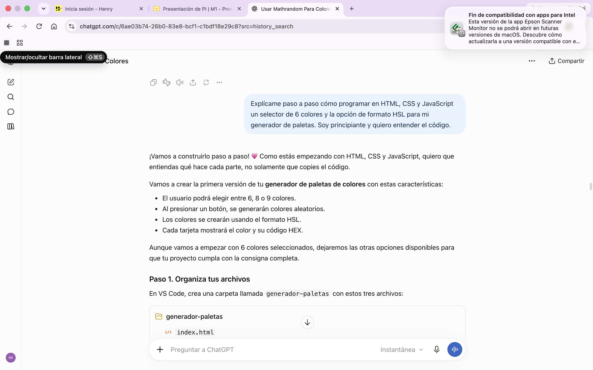
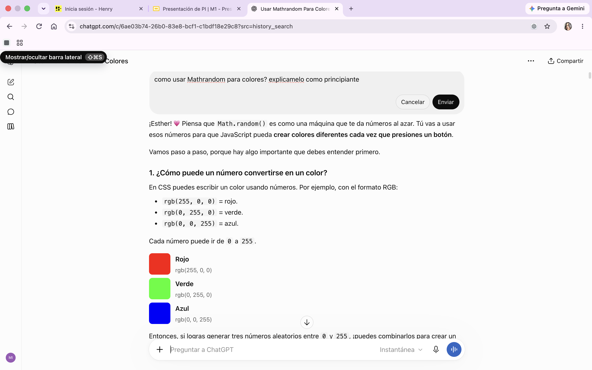

# Documentación del uso de Inteligencia Artificial

## Proyecto: Generador de Paletas de Colores

**Herramienta utilizada:** ChatGPT (OpenAI)

**Objetivo:** Utilizar la inteligencia artificial como herramienta de apoyo para comprender conceptos de programación, resolver dudas y organizar el desarrollo de la aplicación.

---

## 1. Planificación del proyecto

### Prompt utilizado

"Explícame paso a paso cómo programar en HTML, CSS y JavaScript un selector de 6 colores y la opción de formato HSL para mi generador de paletas. Soy principiante y quiero entender el código."

### Resultado obtenido

ChatGPT me explicó cómo organizar el desarrollo del generador de paletas utilizando HTML, CSS y JavaScript.

Me ayudó a comprender cómo crear un selector de cantidad de colores, cómo trabajar con formatos de color y cómo organizar las funcionalidades de la aplicación.

### Aplicación en el proyecto

Utilicé estas explicaciones como guía para comenzar a desarrollar la aplicación y comprender mejor la relación entre HTML, CSS y JavaScript.

La inteligencia artificial funcionó como una herramienta de aprendizaje y apoyo durante el desarrollo.

---
### Evidencia del uso de la IA

## 2. Comprensión de JavaScript y generación de colores

### Prompt utilizado

"¿Cómo usar Math.random para colores? Explícamelo como principiante."

### Resultado obtenido

ChatGPT me ayudó a comprender el funcionamiento de Math.random() y Math.floor(), dos métodos de JavaScript que permiten generar números aleatorios y convertirlos en números enteros.

También me explicó cómo utilizar ciclos y funciones para generar varios colores de manera automática.

### Aplicación en el proyecto

Apliqué estos conocimientos para comprender la lógica de generación de colores aleatorios.

Aprendí cómo utilizar JavaScript para generar una paleta con diferentes cantidades de colores y mostrar los resultados en la página mediante la manipulación del DOM.

La inteligencia artificial me permitió entender mejor estos conceptos y utilizarlos durante el desarrollo.

### Evidencia del uso de IA

